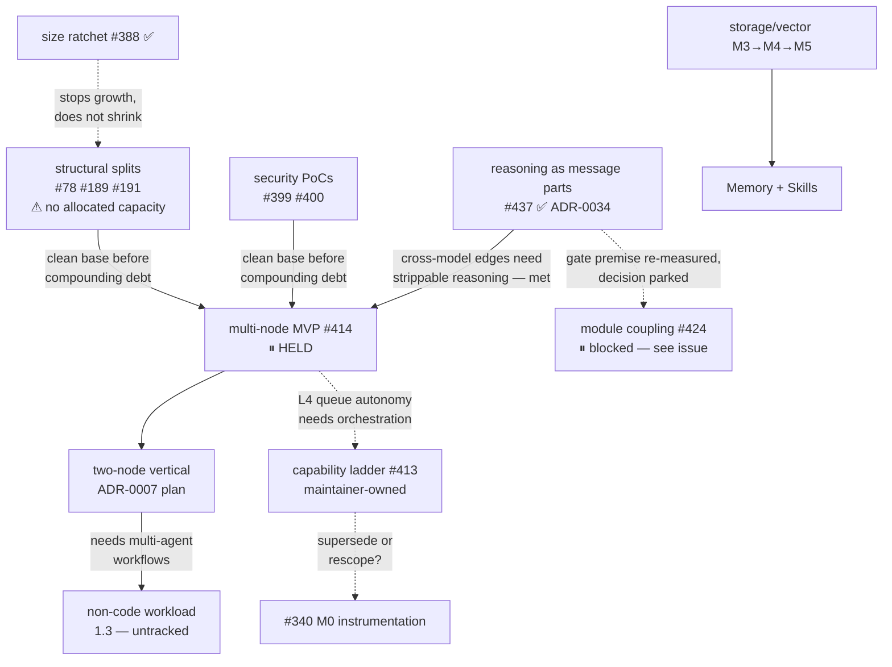

# Status

One screen: what runs today, where we are, what's next. Updated at
milestone boundaries — **last: 2026-09-12** (the dogfood instance
moved onto the compose stack; before it, 2026-09-10, the
production-readiness Phase 0 plan closed with Phases 0 and 1 on
`main`; before that, 2026-08-26, ADR-0006 + ADR-0031: the edge
migration gate reached zero on 2026-08-14 and the `fq`/`fqd` binary
split shipped on 2026-08-23).
If this contradicts `git log`, trust the log and fix this file.

## Maturity: pre-alpha

**There are no external users, no published release, and no compatibility
promise of any kind.** Everything below is built on that assumption, and
so is every review of it.

Concretely, and deliberately:

- **Backward compatibility is not a goal.** Wire formats, event payloads,
  config file names and shapes, CLI surfaces, and on-disk layouts change
  without deprecation windows, version negotiation, or migration code. A
  client and a daemon from different builds are not expected to
  interoperate, and a skew failure is a deploy ordering problem, not a bug.
- **Rollback to an earlier build is not supported.** Deploy tooling may
  assume it only ever moves forward. A rollback that fails is a known
  limitation, not a defect to file.
- **Manual intervention on upgrade is acceptable.** Renaming a config,
  re-pairing a client, clearing state, or hand-fixing a host is a fine
  answer. Prefer a clear failure that names the manual step over
  automation that guesses.
- **Delete transition scaffolding once the transition is done.** Code that
  exists only to straddle two versions is a liability here, not an asset —
  it is untested against the version it claims to support and it hides the
  simple path.

The corollary for reviews: **a finding whose only impact is on
compatibility, migration, or rollback is out of scope** — note it and move
on. Findings about the *current* build's correctness are always in scope.

Revisit this section when the first external consumer appears; until then
it is the licence to keep changing shape quickly.

## What runs today

- **Runtime (`fqd`) and client (`fq`)** — two binaries since the
  ADR-0031 split landed on 2026-08-23: a persistent daemon (event
  projection + trigger dispatcher over NATS/JetStream), and a thin
  client that reaches it only over the authenticated edge. Agents are
  Markdown definitions executed through the suspend/resume
  [reducer harness](docs/guide/reducer-harness.md);
  per-agent model selection, budget enforcement after every LLM call,
  seven sandboxed built-in tools (`file_read`, `file_list`,
  `file_search`, `file_write`, `exec`, `self_inspect`, and
  `report_outcome` — the one that ends an invocation with a declared
  status). Full [MCP client](docs/guide/mcp.md) (spec 2025-11-25):
  stdio + Streamable HTTP transports; tools, resources, prompts, and the
  server-initiated capabilities (sampling, elicitation, roots) — full for
  the handshake-era revisions only: factor-q offers 2025-11-25 and cannot
  yet reach a server that speaks only the stateless 2026-07-28 revision
  (the pin is deliberate, see the
  [2026-11-06 MCP review](docs/reviews/2026-11-06-mcp-protocol-versions.md)).
  Operator surface, spoken by the thin client `fq` (it cannot start a
  daemon — `fqd` is the daemon, and reads `fqd.toml` while the client
  reads `fq.toml`): `fq init / trigger / reload / down / agent / invocation`
  (including `transcript`) `/ events / costs / notifications / status /
  workers / dead-letters / doctor / projection rebuild` (read commands
  take `--json`; `projection rebuild` re-derives the SQLite read model
  from the event stream, which the daemon also does by itself when the
  projection's schema version bumps — see
  [operating the daemon](docs/guide/operating-the-daemon.md)), plus the
  authenticated-edge client verbs `fq connect` (TOFU cert pinning +
  token), `fq ops list`, and `fq token attenuate` (offline token
  narrowing), plus a read-only
  web dashboard (`fq-dashboard`, which reads over the **authenticated
  edge as a second principal**: its own capability token, attenuated
  offline to seven read grants, so a compromised dashboard can read
  exactly what it renders and command nothing — the
  [operator-dashboard plan](docs/plans/closed/2026-07-10-operator-dashboard.md)).
  A **per-model provider throttle** absorbs rate limits fleet-wide and is
  on by default (`[worker.throttle]` in `fqd.toml`): a 429 pauses the
  model for the wait the provider named, halves its in-flight cap, and
  makes the dispatcher hold a paused model's triggers instead of
  redelivering them; an invocation the retry layer gave up on is
  *deferred* at its step boundary (`invocation.deferred`) and resumed
  after the wait rather than failed. `fq status` and `fq doctor` list the
  throttled models and the dashboard's health page shows the same line —
  see [operating the daemon](docs/guide/operating-the-daemon.md).
- **Store (`fq-cas`)** — [content-addressed storage](services/fq-store/README.md)
  (BLAKE3, FastCDC dedup) + named objects with version history + verified
  online GC + [access control](docs/guide/access-control.md) (event-sourced
  grants with delegation/revocation, biscuit capability tokens, default-deny
  gate). Library + CLI (`put/get/object/gc/grant/token`). `fq-cas serve` is
  localhost-only and unauthenticated until M5.
- **Scheduled triggers (`fq-cron`)** — a standalone durable scheduler
  [adapter](adapters/fq-cron/README.md): reads cron jobs from a hot-reloaded
  TOML file and publishes their payloads to NATS subjects (typically
  `fq.trigger.<agent>` for time-driven agent runs). Durable fire state
  survives restarts in a JetStream KV bucket with a per-job missed-fire
  policy ([design](adapters/fq-cron/DESIGN.md)). Ships as the `fq-cron`
  image and in the binary bundle.
- **GitHub watcher (`github-watcher`)** — a standalone Go
  [trigger adapter](adapters/github-watcher/README.md): polls a repo for
  issues labelled `status:ready`, triggers an agent per issue over the
  documented wire contracts, then observes the run's lifecycle events
  and moves the issue's label onward so nothing strands mid-flight. The
  decoder reads every envelope `schema_version` the runtime writes, and
  `just check-schema-versions` fails the gate if a bump ever outruns it
  ([#694](https://github.com/bricef/factor-q/issues/694): a hard-coded
  version 2 silently skipped every completion for the eight days after
  #510). The intake side of the M0 change loop. Since 2026-09-21 the
  last step of every poll also leaves an **advisory merge verdict** on
  each open fleet PR: one `merge:unsupervised` / `merge:supervised` /
  `merge:never` label derived from
  [`.github/areas.yml`](.github/areas.yml) and
  [`.github/merge-policy.yml`](.github/merge-policy.yml), plus one
  comment that also carries a non-deterministic Jev-rubric second
  opinion. It is on by default (`GHW_MERGE_VERDICTS=false` opts out)
  and enabled on the dogfood stack, and it merges nothing — the point
  is to calibrate the verdict against the real PR stream before any
  merge action is considered
  ([#879](https://github.com/bricef/factor-q/issues/879)). Ships as
  the `github-watcher` image and in the binary bundle.
- **Infra** — NATS via `infrastructure/docker-compose.yml`, bound to localhost
  with the public static development token `fq-dev-token`. Do not expose its
  port, and replace the token for any non-local deployment. Build from source
  (`just up`, see [Quickstart](QUICKSTART.md)); `install.sh` awaits the
  first release. Deployed artifacts follow
  [ADR-0035](docs/adrs/accepted/0035-container-image-and-compose-supervision.md)
  (accepted 2026-09-04): every merge to `main` publishes one container
  image per binary to `ghcr.io/bricef`, tagged with the commit its binary
  reports; `ops/dogfood/compose.yml` is the stack and its supervisor,
  `ops/dogfood/deploy.sh` is a tag bump against it (hourly as `--auto`
  from the stack's own `ops` service, ADR-0036, with an idle check and
  automatic rollback), `bootstrap.sh` provisions
  a dedicated host, and `backup.sh` / `restore.sh` make the instance's
  one volume restorable — the build-out is
  [#587](https://github.com/bricef/factor-q/issues/587). The live
  dogfood instance moved onto the stack on 2026-09-12 and runs on a
  dedicated internal host; deploys run hourly via `deploy --auto` from
  the `ops` service, which also runs hygiene and the nightly backup — no
  host crontab. The runbook is in
  [ops/dogfood](ops/dogfood/README.md), and the move itself — pre-flight,
  the restore set, the day's sequence, acceptance, rollback and
  retirement — is recorded in the
  [dogfood host migration plan](docs/plans/active/2026-09-05-dogfood-host-migration.md)
  (opened 2026-09-05).

## Where we are

Phase 1 (the walking skeleton) is
[closed](docs/plans/closed/2026-04-02-phase-1-foundation.md).
[Phase 2](docs/plans/active/2026-04-11-phase-2-mcp-and-memory.md) — MCP,
memory, and skills — is at its midpoint:

| Phase 2 pillar | State |
|---|---|
| 1. MCP client | **Done** |
| 2. Storage + vector foundation | **In progress** — M1 (CAS/index/GC) and M2 (access control) done; M3 (extraction) → M4 (embedding + retrieval) → M5 (service wiring + SDK) remain |
| 3. Memory service | Not started (consumes M4/M5) |
| 4. Skill registry | Not started (consumes M4/M5) |
| 5. Context window management | Not started |
| 6. Agent-definition extensions | `mcp:` done; `skills:` pending |

On the Q ladder, **M0 ("close the loop") is met** as of 2026-07-20: the
autonomous change loop has landed 20+ accepted, `just ci`-validated PRs
against this repo across multiple task types (features, fixes, tests,
docs) — maintainer-confirmed per the done signal of the now-closed
[M0 plan](docs/plans/closed/2026-07-05-m0-close-the-loop.md).

## What's next

The active track is **production readiness**: the
[2026-09-03 review](docs/reviews/2026-09-03-production-readiness-review.md)
sequences Phases 0–5. Its
[Phase 0 execution plan](docs/plans/closed/2026-09-04-production-readiness-phase-0.md)
closed on 2026-09-10 with **Phases 0 and 1 on `main`** (Phase 0's exit
criteria verified on the dogfood host 2026-09-04; Phase 1 code complete
2026-09-06, follow-ups merged by 2026-09-09); the
[dogfood host migration plan](docs/plans/active/2026-09-05-dogfood-host-migration.md)
carried Phases 0 and 1 to the live instance on 2026-09-12, and
Phase 2 (the record is trustworthy) is next, by hand, one PR at a time. The review's standing
answer to "can we also…" **parks the storage M3–M5 track, Memory and
Skills, and the multi-node vertical until Phase 2 is done**. So M3, then M4, then M5
per the
[storage + vector foundation plan](docs/plans/active/2026-06-27-storage-vector-foundation.md)
— with Memory and Skills MVPs on the result — is the shape of that work
when it resumes, not the next thing to start. On the runtime side the
[reducer verification plan](docs/plans/closed/2026-07-05-reducer-verification.md)
is **complete** (claims R1–R7 all oracle-backed in the hermetic CI
path: trace oracle, state validation, sim world, resume equivalence,
crash DST, budget properties, soak — seven real bugs found and fixed
by it; `just soak` scales the lifecycle driver for deep local runs).
The registry-first API + daemon/CLI split (ADR-0006 + ADR-0031) is
**complete**, per the now-closed
[registry-and-split-execution plan](docs/plans/closed/2026-07-20-registry-and-split-execution.md).
Phases 0–2 built the golden net, the `fq-ops` contract crate, and the
authenticated generic edge (`fq-edge`, TLS + capability tokens) wired
into the daemon and enabled by default. Phase 3 proved one declaration
per category through the edge — the `Invocation` view, `invocation.drop`
composing read-your-writes through the public surface alone, and the
`Turn` atom's `turn.get`/`turn.list`/`turn.stream` with `--follow`
riding the stream — and Phase 3e closed decision D-3 with **no
codegen**: shared data definitions in one workspace are the interface,
so ADR-0006's held per-method-generation fallback is formally not
taken. Phase 4, the fleet migration, finished on **2026-08-14**: the
migration gate (`fq-cli/tests/edge_migration_gate.rs`) counts the
operator surface's remaining legacy call points and now asserts
`REMAINING = 0`, so no verb keeps the old path as a fallback — the last
to flip was `invocation.resume`, in the same run as the split. The route
was surveyed call point by call point in the
[Phase-4 call-point inventory](docs/plans/closed/2026-07-28-phase-4-call-point-inventory.md).
Phase 5, the binary split, shipped on **2026-08-23**: the daemon left
the CLI crate for `fq-daemon` and its `fqd` binary, and `fq` is now a
thin client that cannot link the runtime at all —
`fq-cli/tests/thin_client_gate.rs` holds that. `install.sh` and the
release bundle ship `fqd` alongside `fq`, the two configs are split
(`fqd.toml` for the daemon, `fq.toml` for the client), and the dogfood
deploy runs the split pair.
The dogfood loop **lands PRs**: the daily `doc-drift` agent
(fq-cron-scheduled) now opens its own docs-only PRs for drift it can
verify and fix, and files issues for the rest; alongside it the
`github-watcher` adapter triggers
an `m0-issue-fix` agent on `status:ready`-labelled issues (agent
definitions in the instance's own tree, outside this repo: the instance
volume, version-controlled in the `bricef/fq-dogfood` ops repo); the
agent makes the change in a sandboxed working copy, validates with
`just ci`, and opens a PR behind the human merge gate — the loop that
met M0 (see the closed
[M0 plan](docs/plans/closed/2026-07-05-m0-close-the-loop.md)).
Exactly-once trigger dispatch on that track is **decided, as of
2026-11-11** ([#835](https://github.com/bricef/factor-q/issues/835)):
the durable claim that closed the duplicate-start gap on 2026-09-16
([#809](https://github.com/bricef/factor-q/issues/809); the
originating incident
[#327](https://github.com/bricef/factor-q/issues/327) is closed) is the
design, and the trigger inbox that the now-closed
[plan](docs/plans/closed/2026-07-18-exactly-once-trigger-dispatch.md)
set out is not built.
[ADR-0032](docs/adrs/accepted/0032-exactly-once-trigger-dispatch.md) is
accepted in that form. The dispatcher arbitrates every delivery against
a durable claim row in the control-plane store — keyed on the trigger
stream, the epoch of the stream incarnation it connected to, and the
sequence — before it drains, routes, or parses anything: a copy of a
trigger this daemon is already holding is dropped, and a copy of one
whose invocation has durably started is acked and dropped (`fq status`
and `fq doctor` count both kinds, apart). The trigger is still acked at
the invocation's first WAL write (`DurableStart`, #41), which is what
bounds the older failure, a long invocation outliving its ack deadline
and being re-run. The design is correct for one daemon and assumes one.
ADR-0032's section
[What this means for more than one worker](docs/adrs/accepted/0032-exactly-once-trigger-dispatch.md#what-this-means-for-more-than-one-worker)
says what that leaves unbuilt and carries the named exit condition:
the decision is reopened **before a second process consumes the trigger
stream**. **Phase 2's exit criterion is amended** to match. The
production-readiness review's "the incident-replay integration test
from the exactly-once plan passes" named the gate of the plan's PR-3,
which is not built; it now reads: the two replay tests in
`fq-runtime/tests/july_incident_replay.rs`
(`an_invocation_that_outlives_the_ack_window_is_not_redelivered` and
`a_trigger_redelivered_before_its_first_wal_write_starts_once`) and the
twelve dispatcher and store unit tests ADR-0032 names pass in
`just runtime-ci`. The review is a snapshot and is not edited. The
2026-07-18 replay now produces its broker-own redelivery by blocking the
stalled invocation's thread, because the setup keepalive
([#1039](https://github.com/bricef/factor-q/pull/1039)) closes the
route ADR-0032's section 5 says it used, a start slower than the ack
window; the property it certifies is unchanged, and a third test in
that file, `a_setup_that_outlasts_the_ack_window_is_not_redelivered`,
pins that an awaiting setup longer than the production window is not
redelivered. ADR-0032's one edit since 2026-11-11 records the finished
retry ladder (2026-11-14); it is not edited for the keepalive, for the
settling of a daemon's own claims, for the dead-letter watch's reading
of the records, for the mark's report of what it marked, for the
release's scope to its own invocation or for the claim's consumed
state, so these of its statements are
now out of date: section 5's account of the two routes to a redelivery
before durable start, and of the replay using the second; gap 3 as a
whole, now closed (below), its "a start that takes longer than the whole
retry ladder" included; the row of section 2's table for a claim the
same process holds, which "Stops" with "No log line and no count";
section 3's "writes `durably_started` and the invocation id", since the
mark now writes only the state, on a claim already naming the run;
section 4's "leaves no row behind", since a release the claim store
refuses, or one settling gives up waiting for that never lands, leaves
the claim `claimed`; section 4's account of the release, which "deletes
the row if and only if it is still `claimed`", since it now also
requires the row to name the invocation giving it back; and, in its part
on more than one worker, "where nothing keeps it alive", "in a slow
start", that a trigger whose durable-start report never arrives "is
dead-lettered as exhausted while its invocation runs", since the watch
now holds its verdict while a copy handles the claim,
"`mark_trigger_started` updates by key alone, so A and B both mark, and
the row keeps whichever invocation id was written last", since a mark
now matches only the claim naming its run, and that
`release_trigger_claim` "deletes by key and `state = 'claimed'`", since
a release now deletes only the claim naming the invocation giving it
back; and section 2's account of the row, in "schema version 2", since a
later rung rebuilt the table. The third claim state, `consumed`, and the
answers that write it, which replace section 4's "Every other ack gives
the claim back" for every answer that deals with a trigger without a
run, are recorded in
[ADR-0038](docs/adrs/accepted/0038-a-trigger-dealt-with-and-not-run-keeps-its-claim-consumed.md),
which refines ADR-0032.
The
retry ladder is finished
([#953](https://github.com/bricef/factor-q/issues/953)): the trigger
durable retries after 30 seconds, then 2, 5 and 12 minutes, and
dead-letters a trigger that fails every delivery 19.5 minutes after its
first. The trigger-to-invocation link is readable
([#954](https://github.com/bricef/factor-q/issues/954)): `fq invocation
show` names the delivery that started a run, and `fq doctor` lists
claimed deliveries that never settled, by what the claim, the stores
and the stream can show (a delivery that never started a run, a run
whose claim was never marked), while never reporting a claim the
running daemon holds for a run that has not started. The claim table
no longer grows without bound, the fifth gap ADR-0032 lists
([#969](https://github.com/bricef/factor-q/issues/969)): the retention
sweep deletes a claim `[state] trigger_claim_retention_days` (default
90, raised from 30 in [#1014](https://github.com/bricef/factor-q/issues/1014); any
negative value keeps every claim indefinitely) after it was claimed, a
window the config refuses below the trigger stream's message age plus a
day, and never deletes a claim the running daemon holds; `fq doctor`
stops listing a dead claim at the same age, and nothing clears a claim
that never started a run sooner
([#1029](https://github.com/bricef/factor-q/issues/1029)).
The table has no index yet
([#989](https://github.com/bricef/factor-q/issues/989)). ADR-0032 lists the gaps the design knowingly leaves open. The first of
them no longer is: a daemon that died between an invocation's first WAL
write and its claim being marked started used to have the redelivered
trigger run a second time beside the resumed invocation. The claim row
now names the invocation from claim time, and startup recovery marks
the claim of every invocation it finds in flight before the dispatcher
consumes a trigger
([#959](https://github.com/bricef/factor-q/issues/959)). Since
[#1030](https://github.com/bricef/factor-q/pull/1030) it marks the claim of a
finished run too: every `claimed` row whose run has a start on record,
in the worker's WAL or in the control plane's ownership table, the
records `fq doctor` reads to call a claim "started, never marked". A
claim left `claimed` for a run that ended is therefore no longer adopted
and run a second time by a redelivery, or by a replay from a recreated
consumer, after a restart. The second
no longer is either: an invocation that fired its durable-start signal
and returned within one poll used to be settled as if it had never
started, its claim released and a transient error NAKed for a second
run. The dispatcher now asks the signal once more when an invocation
returns, and tests pin that the runner fires the signal only once its
first WAL write has landed
([#966](https://github.com/bricef/factor-q/issues/966)). The fourth,
a duplicate dropped before durable start leaving no trace, is closed
too: a copy that meets a claim this daemon holds with no start recorded
used to be refused without a log line or a count, and is now logged at
warn with its subject, sequence and attempt, the claim's age and the
invocation id the claim names, and counted apart from copies of a
started run (`fq status` and `fq doctor` name the two by whether the
copy came before or after a start was recorded). Both counts are kept
in memory and start again with the daemon
([#968](https://github.com/bricef/factor-q/issues/968)). The third gap,
a live process holding a claim it will never settle, is closed too
([#967](https://github.com/bricef/factor-q/issues/967), in five
changes). A durable-start mark the claim store refuses no longer
stops the run: the dispatcher offers the mark again for up to two
seconds, keeping the delivery alive meanwhile, and a mark still refused
is answered by acking the delivery without releasing its claim, so the
run carries on and is neither redelivered nor falsely dead-lettered
([#1021](https://github.com/bricef/factor-q/pull/1021)); the next start's
recovery then records that run's start, as above. A mark that lands but
finds no claim naming its run now says so, and the start is recorded
all the same, since the claim is what refuses a copy of the trigger: a
claim that is gone is written, recording the start; another
invocation's claim that has not started has this run's start recorded
in its place; another run's start already on the claim is left. The
delivery is then acked keeping the claim, and each case is logged at
error. Before, the mark reported success whatever it matched, so a
trigger whose claim was gone was acked with no record that it had run,
and a lost ack or a replay of the stream started it again
([#1046](https://github.com/bricef/factor-q/issues/1046)). One daemon
reaches none of these: its one route, a release settling gave up
waiting for that stalled about 70 seconds outside SQLite's lock waits
and landed after a copy took the claim again, closed when a release was
scoped to its own invocation (below). The dispatcher also
keeps a delivery alive from its worker permit to its first WAL write,
as the holds before it and the mark after it do, so a slow setup is no
longer redelivered underneath its own first copy, and a setup slower
than the whole retry ladder is no longer dead-lettered as exhausted
while it is still starting; the keepalive lets go on a drain or
shutdown ([#1039](https://github.com/bricef/factor-q/pull/1039)). It
keeps a delivery alive while it is settled too, from the run's return,
or the trigger's refusal, until its NAK or ack is published, through the
claim's release and, on a last delivery, the dead letter's publish, so a
release slow enough to outlast the ack window no longer lets a copy
arrive, take the freed claim and handle the trigger a second time
([#1057](https://github.com/bricef/factor-q/issues/1057)). Settling
waits at most 40 seconds for the release, longer than the claim store's
own waits (30 seconds for a connection, 5 for its lock), then answers
the delivery without it and logs `gave up waiting for the claim store to
release a trigger's claim` at error. Giving up stops the wait, not the
release, which lands when the store lets it. A release removes the claim
only while the claim is still `claimed` and still names the invocation
giving it back, so one that lands late cannot delete a claim a copy has
taken again since
([#1061](https://github.com/bricef/factor-q/issues/1061)); the 40
seconds are what lets every release the store answers, landed or
refused, be logged as what it was. A
setup that hangs before its first WAL write is therefore kept alive,
and nothing reports it
([#1040](https://github.com/bricef/factor-q/issues/1040)). A copy
that meets a claim the daemon holds itself is settled by what is on
record instead of always being dropped
([#1041](https://github.com/bricef/factor-q/pull/1041)): while a copy of
the trigger is still handling the claim, until its start is marked or
its mark gives up, it is dropped, as before; once none is, a run with a
start on record, in the worker's WAL or the control plane's ownership
table, has the copy acked and the claim marked, whether the run is still
going or has ended, and a run with none has the claim taken again under
a new invocation id to run the trigger, counted in `fq status` and
`fq doctor` as an abandoned claim taken again. A task that panicked in
the very step that made its first WAL write is the first kind: its
trigger is not run again, and its run waits in flight for the next
start's recovery. And the dead-letter watch decides by the same records
before it calls a trigger exhausted, the fifth change: a trigger whose
last delivery's answer never reached the broker while its run had a
start on record (that delivery started the run and its task then died,
or its mark landed or gave up and its ack was lost, or it was a copy of
a run started earlier and its ack was lost) is not dead-lettered; its
claim is marked, then or, if that mark fails, at the next start, and
`fq status` and `fq doctor` count it as exhausted but started. A
trigger with nothing on record is dead-lettered as
before. While the records cannot be read, a copy of the trigger is
still handling its claim, or the claim changed between the watch's two
reads of it with no start found, the watch holds its verdict and
decides again when the advisory comes back, rather than write a dead
letter that could be false; a start it has found, the claim marked or
the run in the WAL, is never held. A copy's delivery is renewed until
its start is marked or, if it does not start, until the delivery is
answered, so a copy is still handling a claim when its deliveries run
out only if its renewals stopped before either: a drain or shutdown let
it go while it waited or set up, its renewals did not land, or its setup
blocked its thread. A hold ends about an hour after
the broker emitted the advisory, and not before the watch has looked
at it three times, far inside the day the advisory stream keeps it,
since an advisory dropped while held would leave no dead letter at
all: a last look then counts any start it finds, and otherwise the
watch writes the dead letter anyway, logs it at error, and marks it in
`fq dead-letters list` as one whose start was not checked, with the
reason and the invocation the claim names. That dead letter can be
false, since the run may have started, or may start after the hour, and
requeuing it then would run the work twice. So `fq dead-letters requeue`
takes the verdict itself, for every dead letter that carries a trigger
id, marked or not, before it reserves or publishes anything (one with
no trigger id it refuses before reading any record), asking the records
the watch asks
([#1059](https://github.com/bricef/factor-q/issues/1059)): the
trigger's claim and the run it names and, when that cannot tell, the run
a marked dead letter names, by its own id. A run with a start on record
in any of them is refused, naming it, whatever the operator passes;
nothing on record is requeued; and when it cannot tell (the records
cannot be read, a copy is still handling the claim, or a marked dead
letter's claim is gone, given back or swept, which look the same, with
nothing found under the run it names) it is refused unless the operator
passes `--checked-not-started`, with the dead letter's `--trigger-seq`,
after checking the run it names. What stays open is narrow. That flag is
the operator's word, and a copy still handling the claim can start the
run after they look. An unmarked dead letter whose run started after it
was written, by a copy its writer did not see such as a replay of the
stream, is refused while its claim is kept and reads as nothing on
record once the claim is swept. With the defaults that cannot happen to
a dead letter still listed: a dead letter is an event, kept for
`[events] max_age` (30 days), and a claim for
`[state] trigger_claim_retention_days` (90 days, never under two), so
the dead letter leaves the log first. It can happen when the claim
window is set below the event log's, or the event log kept longer than
the claims ([#1076](https://github.com/bricef/factor-q/issues/1076)).
And a dead letter written before the trigger stream was last created is
not judged by the stream's claims, which key on its incarnation, so an
unmarked one is requeued without a look. Which incarnation a dead letter
belongs to is told by comparing its timestamp, this daemon's clock,
with the stream's creation, the broker's, so a skew between the two
clocks moves that line by as much
([#1077](https://github.com/bricef/factor-q/issues/1077)). An advisory
emitted before the trigger stream was last created is dead-lettered
without a look at the claims, since its sequence names a message of the
old stream, so its dead letter may record a trigger whose run started.
Every dead letter this build writes for a trigger of the stream the
daemon is connected to records that stream's incarnation
(`trigger_stream_epoch`, the value the claims key on), the dispatcher's
and the watch's alike, so a dead letter for the message at a sequence
can be told from one for the message an earlier stream held there. It
is the value the daemon read when it connected, so a daemon left
running over a recreated stream stamps the old stream's value on a new
trigger's dead letter
([#1065](https://github.com/bricef/factor-q/issues/1065)). An
earlier incarnation's advisory is no longer attributed to the message
the new stream holds at that sequence: the watch reads nothing there and writes the dead letter for
the system with no subject, payload or trigger id, which
`fq dead-letters requeue` refuses, and `fq dead-letters list` says why
it names no trigger
([#1054](https://github.com/bricef/factor-q/issues/1054)). A
redelivered advisory no longer writes such a dead letter twice, nor one
that names its trigger. The form for a trigger that aged out of the
stream now says why it names no trigger too: what the broker
answered and when the watch last read the stream, when the advisory was
emitted, and that the message most likely aged out. So every dead letter
this build writes naming no trigger says why, and of what kind
(`unattributed_kind` in `fq dead-letters list --json`); one an older
build wrote for an aged-out trigger stays a bare `system` row for the
events stream's 30 days. The listing also says when such a dead
letter's start was not checked, which is always so for an earlier
incarnation's, and does not offer `fq dead-letters requeue` for a row
that names no trigger. It still offers it for a header-less row, one the
watch wrote for a trigger published without an id, which lists like a
requeueable one and is refused
([#1080](https://github.com/bricef/factor-q/issues/1080)), and for a
row under `system` whose trigger's subject names no agent, which records
that subject and its payload: refused when it carries no trigger id, and
requeued to `system` rather than to its subject when it carries one
([#1098](https://github.com/bricef/factor-q/issues/1098)). The watch writes the aged-out form only when the broker answers that it
holds no message at the trigger's sequence: a read that fails for any
other reason holds the verdict, as unreadable records do, and past the
hour and three looks, unless a last look at the records finds the run
started, the dead letter is written naming no trigger and saying the
message could not be read. The records are asked before the message is
read, and before the check for a dead letter already written, since
they key on the advisory's sequence and need neither: a run that
started is found at once however its message reads, and settled as
started even when a dead letter for it is already on the log. One
exhaustion gets one dead letter, whichever form came first. The watch
remembers the advisories it wrote since it started, and answers a copy
of one without reading the log. Every dead letter it writes carries the
broker's id for its advisory, and before writing one it reads the
trigger's agent's `failed` events since the trigger was published for
one that is certainly this trigger's: at its sequence, recording this
stream's incarnation, and naming its id when it has one; one recording
no incarnation is never taken, and an id-less trigger's match on the
sequence and incarnation alone is trusted only once the broker says
the stream is still the incarnation the watch holds (a match on the id
is not asked about, so a daemon left running over a recreated stream
takes an earlier stream's dead letter that names an id for that id
published again at the same sequence, and writes none; requeue is
keyed on the id, so the work stays requeueable from the earlier one);
or, for one filed
for the system, every agent's since the advisory for one carrying the
advisory's id. Where a check cannot be certain, or cannot be made by
the hour and three looks, the dead letter is written, and says so
(`duplicate_check`) when the check could not be made: a second, never
none. A named dead letter may still follow a nameless one, since it is
the one that can be requeued. A backlog of advisories after a restart
costs about the square of its size to check, losing nothing while it
clears within the advisory stream's day
([#1087](https://github.com/bricef/factor-q/issues/1087)), and with
`[events] max_age` below a day a dead letter can age out before its
advisory and be written again. No known path loses a dead letter to the
check. These still write a second
([#1091](https://github.com/bricef/factor-q/issues/1091)): a dead
letter the dispatcher publishes after the watch has looked; a nameless
one after the dispatcher's own named one, which carries no advisory id,
when the trigger's message is gone by the watch's first look; a check
that cannot be made by the limit, for one an earlier run of the daemon
wrote; an advisory with no id; a daemon left running while its trigger
stream is recreated ([#1065](https://github.com/bricef/factor-q/issues/1065)), whose
watch writes a second for a trigger published without an id whose dead
letter is already on the log stamped with the earlier incarnation, and
a watch started after the recreate a third; and the servers' clocks.
For a trigger
published without an id, the second can be the watch's with no trigger
id, which `fq dead-letters requeue --trigger-seq` then takes and
refuses, leaving the dispatcher's unselectable. What the check takes on
trust is which message the advisory names: the two readings below
([#1066](https://github.com/bricef/factor-q/issues/1066)). Two readings
of an advisory's incarnation still attribute it to the message at its
sequence. One with no timestamp the watch can read is taken as the
current incarnation's, though the broker always stamps one. And the
incarnation is the one the daemon read when it connected: deleting the
trigger stream under a running daemon stops the daemon within about a
second, its dispatcher's consumer gone with the stream, and the next
start creates the stream again and reads the new incarnation; but a
stream deleted between two of the dispatcher's pulls leaves the daemon
running and consuming nothing, and its watch then reads an advisory
emitted before the recreate at its sequence in the new stream
([#1065](https://github.com/bricef/factor-q/issues/1065)). A claim written before claims named
their run is dead-lettered without a look at the records, as before. A
trigger consumed without its run starting (it failed for good before its
first WAL write, was refused at admission, was requeued from a hold, or
was halted in setup, among others) no longer has its claim released
before its delivery is acked, which let a lost ack bring the delivery
back to be handled again: a trigger that failed for good failed again,
one requeued from a hold could run twice, and on the last delivery the
watch found no claim and wrote a `trigger_exhausted` for a trigger
already dealt with
([#1055](https://github.com/bricef/factor-q/issues/1055)). Every answer
that consumes a trigger without a run now records its claim `consumed`,
with how in `consumed_why`, and then acks, so a lost ack, or a stop
between the write and the ack, leaves a consumed claim, and the copy the
broker brings back is acked and dropped; on a last delivery the watch
writes no second dead letter. Every reader honours the state: a copy
that meets one is acked and dropped and the watch writes no dead letter
for it, each counted on `fq status`, `fq doctor` and the dashboard apart
from the runs that started (save one consumed as dead-lettered, which the
watch answers as a dead letter already written and counts in neither),
requeue proceeds for one consumed as
dead-lettered, refuses one requeued from a hold whatever it is told, and
takes one consumed for any other reason only on the operator's word,
adoption, re-take, recovery and `fq doctor` leave it, a start found over
one is recorded over it, the sweep takes it with the started claims,
and `fq invocation show` names it, with an operator's drop when the
claim records one. The watch and requeue do not take it on trust: a
start on record for the run it names is a start (for a claim that
records an operator's drop of the run, only a start in the WAL, since
the drop writes the run's ownership row), and the claim is marked so;
one whose records cannot be read is never dead-lettered, and requeue
cannot tell. An operator's drop of a run that never made its first WAL
write is recorded on its consumed claim beside the reason, never in its
place, by whichever of the consume and the drop lands second, so a
trigger the dispatcher dead-lettered and whose run was then dropped
keeps `dead_lettered` and its dead letter is still requeued. The
decision is recorded in
[ADR-0038](docs/adrs/accepted/0038-a-trigger-dealt-with-and-not-run-keeps-its-claim-consumed.md),
which refines ADR-0032. Four things stay open, tracked in
[#1113](https://github.com/bricef/factor-q/issues/1113): a consume the
claim store refuses, with a lost ack on top, still lets a copy take the
claim again and handle the trigger a second time, which only holding the
ack on the store would close; a stop between a hold's replacement
publish and the consume leaves the original to be adopted and run beside
its replacement; a dead letter the watch wrote before this change for a
trigger that would now count as consumed stays requeueable; and the
drop's handler records the drop before it writes the run's ownership row
and again after, which leaves one instant two statements wide: a
consume that lands between the first record and the row records
nothing, and until the second record a reader takes the row for a start
and marks the claim started for good, which errs on the cautious side
and which writing the row and the claim's record in one transaction
would close. A slow
release or consume does not lead to a second handling either, since the
delivery is kept alive until its answer is published
([#1057](https://github.com/bricef/factor-q/issues/1057)). A trigger
that fails transiently before its first WAL
write on its last delivery, and whose dead letter the dispatcher cannot
publish, is no longer acked: the dispatcher gives its claim back and
NAKs the delivery with no delay, the broker reports the trigger
exhausted at once, and the watch, finding nothing on record for it,
writes the dead letter, trying again until the events stream takes it,
for as long as the advisory stream keeps the advisory, a day
([#1062](https://github.com/bricef/factor-q/issues/1062)). Three things
stay open there. The watch's dead letter does not carry the error that
ended the last delivery: the dispatcher's error line records it beside
the trigger's sequence, the one record of it that names the trigger. A
trigger published without a trigger id, as `fq-cron` publishes them
([#1080](https://github.com/bricef/factor-q/issues/1080)), is given one
by the dispatcher for each delivery, and the dispatcher's own dead letter
would have carried it; the watch does not invent one, so its dead letter
names no trigger id, `fq dead-letters requeue` refuses it, and the work
is run again as new work with `fq trigger`; the id on the dispatcher's
error line then matches no dead letter, and only the sequence ties the
two. And a trigger can still get two dead letters, one from each
emitter, under one sequence, when the dispatcher's publish reached the
events stream only after the watch had looked for it, or the watch's
check could not be made by its limit; the same holds, as before, for a
dead letter the dispatcher published whose delivery's ack never reached
the broker. Another failure of the agent in between, or a read that
fails, no longer makes the watch miss the dispatcher's
([#1066](https://github.com/bricef/factor-q/issues/1066); what is left
is [#1091](https://github.com/bricef/factor-q/issues/1091)).
Outside
ADR-0032, startup recovery's resumes and `fq invocation resume` now wait
for a `max_concurrent_invocations` permit like every other run, as a
deferred resume already did, so a restart no longer runs its recovered
invocations on top of the cap, and they start ahead of any new trigger
(the review's finding C5,
[#994](https://github.com/bricef/factor-q/issues/994)). A plain
`fq invocation drop` takes such a waiting run before it starts, and an
invocation deferred for a rate limit too, asleep, waiting for its
permit, or in the instant it is put down: it is not resumed and asks the
model nothing more, and one
still asleep gives its agent's slot back at the drop rather than at the
end of its wait ([#1070](https://github.com/bricef/factor-q/issues/1070)).
An operator's
`fq invocation resume` is the one run not held at its agent's
`max_concurrent`: it counts against that limit, so the agent can be
over it until one of its invocations ends, and the command says so
([#1009](https://github.com/bricef/factor-q/issues/1009), whose second
part, a rate-limited run resumed at once after a restart, is open).
Startup recovery no longer reports a resumed invocation that ended in
`failed` as `invocation.ambiguous`: it decides from the worker's row,
not from the error the resume returned, so only a resume that leaves
the invocation in flight is reported
([#1005](https://github.com/bricef/factor-q/issues/1005)). The archive
hand-off no longer stops at a row it cannot publish
([#981](https://github.com/bricef/factor-q/issues/981)): the sweeper
holds such a row (an event too large for the broker, a stored event
this build will not republish, ids that cannot go on an event), keeps
it whole, goes on to the rows behind it and offers it again at the next
start, and `fq doctor` and `fq status` list the holds with their reason
and remedy. `invocation.archived` now carries the run's state as base64
text, four bytes on the wire for three of state where it was about four
for one, so a run holding up to about 786,000 bytes of state (two tool
results at the default cap) archives on a stock 1 MiB broker. The
control plane's ownership row follows a run's outcome, not the
hand-off of its archive
([#1024](https://github.com/bricef/factor-q/issues/1024)): a
`completed`, or a `failed` outside `setup`, moves the row to that
ending when it is folded, and a new `archive_state` column beside the
status records whether the control plane holds the run's archive
(`pending` until it does), so a run whose archive is late, refused or
held reads as finished. `fq invocation list` and the dashboard show
the archive's state, `held` included while the worker's archive sweeper
holds it; `fq invocation show` adds the hold's reason and remedy; and
the JSON of the worker detail's owned rows carries the state. Every
move of the
row is decided by one transition function and written as a
compare-and-set on the state it was decided from: a late
`invocation.ambiguous` never puts a finished run back to triage, an
operator's drop of a run that has ended keeps that ending and records
its request beside it, a second ending is refused and logged at
error, and a `failed` in `setup` (published only while the run's WAL
holds no row) writes no row, so it records no start. A row this build
cannot read is left as it is, and no event, start or stuck sweep waits
for it; the list and detail reads, `fq doctor` and the retention sweep
still fail on it, and only a hand edit clears it
([#1082](https://github.com/bricef/factor-q/issues/1082)). A
run that fails mid-step now marks its WAL row finished, with its
`failed` stored, before it publishes it, so it cannot publish its
`failed` and die before its mark; a publish lost after the mark is the
archive sweeper's to repeat, and the mark has one winner against an
operator's drop ([#1070](https://github.com/bricef/factor-q/issues/1070)). A run whose `failed` an older build
published before dying unmarked is no longer resumed at the next start,
whether or not the coordination consumer folded that `failed` before
the daemon died: startup recovery now decides only after the consumer
has folded what was on the event stream when the start began, so a
`failed` or a drop the dying daemon published is on record first
([#1070](https://github.com/bricef/factor-q/issues/1070)). The wait is
bounded by `[worker] recovery_backlog_wait_secs` (30 seconds), and ends
at once if the consumer halts on an event this build cannot read; a run
it could not check is logged at error and left in flight for a later start
to resume once the fold has caught up (resuming it without a restart is
[#1089](https://github.com/bricef/factor-q/issues/1089)), and the
consumer's tick sweeps wait until recovery has decided. A delivery the stopped daemon left unacknowledged holds the
fold for the coordination consumer's five-second ack window, well
inside that bound. A run
started from a trigger has its row from its first WAL write, written by
the dispatcher once it has marked the trigger's claim, so it is in
`fq invocation list` while it runs, under the daemon's worker id and
from its own start; a run whose row that write could not make, or one
an earlier build started, has none until it ends or is restored
([#721](https://github.com/bricef/factor-q/issues/721)). A run whose
stored terminal event the archive sweeper holds, because this build
will not republish it or the broker refuses it for its size, reads
finished too: the sweeper publishes `invocation.ending_held` in its
place, folded as that ending
([#1071](https://github.com/bricef/factor-q/issues/1071)). Still open: a run whose row's ids cannot go on an
event can publish nothing, so its row stays as it was; the readers that
key on a run's own `completed` or `failed`, the summariser's outcome
line and the turn list among them, do not read a held ending yet
([#1100](https://github.com/bricef/factor-q/issues/1100)); a row that
read `in_flight` before this change for a run that had already ended
keeps reading so until the run's archive arrives, or for good if the
archive is held, since a build before this one consumed that ending
without moving the row and it is not folded again; and the row
and the run's archive record can disagree when an archive names the
other ending; an operator's drop no longer writes an archive record,
and records its request beside the run's outcome instead of rewriting
it ([#1070](https://github.com/bricef/factor-q/issues/1070)). The
operator surfaces read that record: `fq invocation list`, `show`,
`fq workers show` and the dashboard say who ended a run and when, and
the first termination request beside its ending, and
`fq invocation drop` succeeds whenever the run exists and says what that
drop found, read from its own time. Still open there: a drop of a run
that failed in `setup` reads as having ended it
([#1121](https://github.com/bricef/factor-q/issues/1121)), and a drop of
a run whose archive is on record but whose row has not ended leaves the
row `pending` for good
([#1120](https://github.com/bricef/factor-q/issues/1120)). And an
event the broker refuses for its size now ends its run
([#828](https://github.com/bricef/factor-q/issues/828)): one terminal
`failed` of kind `payload_too_large` names the refused event, its size
on the wire and the broker's limit, where before the run was left in
flight, resumed into the same refusal and reported ambiguous on every
start. The M0
plan's deferred proxy instrumentation (read relative to an
expert+frontier baseline) to make **M1 (Q1)** decidable now has its own
track: the
[measurement instrument plan](docs/plans/active/2026-09-17-measurement-instrument.md)
(opened 2026-09-17 for
[#340](https://github.com/bricef/factor-q/issues/340) and the capability
ladder's §6,
[#413](https://github.com/bricef/factor-q/issues/413)) sequences five
deliverables — the attempt ledger, the objective diagrams and measures,
the human-entered primitives, the trajectory plot and the weekly
report. Three of them are on `main`. The human-entered primitives landed
2026-09-17: `just touch` and `just tag` append typed interventions,
touch minutes and baseline-equivalent size tags to logs kept on the
orphan `metrics` branch, never merged into `main` (see
[measurement logs](docs/guide/measurement-logs.md)); the rubric that
makes those entries mean the same thing month to month landed
2026-09-20 ([#840](https://github.com/bricef/factor-q/issues/840), see
the [measurement rubric](docs/guide/measurement-rubric.md)). The
attempt ledger landed 2026-09-18
([#838](https://github.com/bricef/factor-q/issues/838)):
`just metrics-extract` builds and incrementally updates
`attempt_ledger.sqlite` from issue timelines, pull requests, the event
log, git history and the intervention log — see the
[extractor README](tools/fq-metrics/README.md). The objective diagrams
and measures landed 2026-09-20
([#839](https://github.com/bricef/factor-q/issues/839)):
`just metrics-report` reads that ledger and writes the cumulative-flow
diagram, accepted-change throughput, stage cycle-time distributions and
the ladder's derived measures and costs as `report.md`, `report.json`
and SVGs — the baseline-equivalent throughput line is deferred to the
trajectory work. The trajectory plot and the weekly report are not
built yet, so M1 is still undecidable. The security-sequencing
question that the [2026-07-05 project assessment](docs/reviews/2026-07-05-project-assessment.md)
raised now has a dated answer: [SECURITY.md](SECURITY.md) is the
canonical posture — what is enforced today, what is intended, and a
risk register of the open exposures — and
[ADR-0037](docs/adrs/draft/0037-isolation-sequenced-after-graph-execution.md)
(draft, proposed 2026-09-22) records the hold that sequences isolation
after the graph executor's first pass (#414), with its named exit. The
assessment's other open strategic questions still stand there.

## How the work is sequenced — a July 2026 snapshot

*Deliberately not refreshed.* This section is a record of what was
believed to gate what as of late July 2026, kept because its whole
purpose is showing that a hold was reasoned rather than neglected, and
because the maintainer-confirmation dates in it are themselves the
record. Read it as history, not as today's state — for that, see
"Where we are" above.

A coarse map of what gates what. It exists because a hold is
indistinguishable from neglect unless the reason is written down: the
graph-executor plan sat untouched for three weeks and read as
abandoned, when it was deliberately waiting on security and structural
work. Workstream-level only — per-issue dependency trees come from
`issue-graph` against GitHub sub-issue links, not from this diagram.
**Rule: anything held carries a named exit condition.**

Reading the diagram: solid arrows are hard gates; dashed arrows are
open questions or weak couplings. Of the exit criteria drawn into #414,
five (#399, #400, #78, #189, #191) are **proposed and not yet confirmed
by the maintainer** — read them as a candidate release condition for
the hold, not a settled one. #437 was different — a contract
precondition rather than debt-avoidance, confirmed by the maintainer on
2026-07-28 — and **it is met**: [ADR-0034](docs/adrs/accepted/0034-reasoning-as-a-content-part.md)
makes `Message` an enum over turn kinds with reasoning as a first-class
part, and the cross-model strip a multi-node graph needs (ADR-0003
guarantees per-agent model selection, so cross-model edges exist by
construction) is enforced at the adapter (PR #510). Reasoning now
round-trips for OpenAI-compatible, Anthropic and Gemini providers, and
for all three routed through OpenRouter. Every carrying row is
confirmed live: the OpenAI-compatible and Anthropic rows on 2026-09-04
and again on 2026-09-05 (kimi-k3 via OpenRouter, `claude-opus-5`,
`gpt-4o-mini` as control), Gemini on 2026-09-07 (`gemini-3.8-flash` via
AI Studio, on top of the mock and wire goldens the row landed with,
PR #600), and signed reasoning through OpenRouter on 2026-09-08
(`anthropic/claude-sonnet-4-6`) — in each case every reasoning part was
carried byte-for-byte into the next request
(`experiments/reasoning-round-trip/`, live run section). The one route
that used to drop signed and encrypted `reasoning_details` on the way
back — through OpenRouter — now carries them, so
[#603](https://github.com/bricef/factor-q/issues/603) is closed; the
gap left hermetic-only is a Gemini turn with visible text before a
signed call. Per-provider detail, and how each row was verified, is in
the [reasoning-models guide](docs/guide/reasoning-models.md). The
Anthropic path no longer rides a fork of `genai`: upstream carries the
signed-thinking fix since `0.7.0-beta.21` and the three changes
factor-q sent upstream since `0.7.0-beta.23`. factor-q pins an exact
upstream release — the current pin is in
[`fq-runtime/Cargo.toml`](services/fq-runtime/crates/fq-runtime/Cargo.toml)
and moves with Dependabot — and each switch is held by wire goldens
that did not move.

Issue #424's block on #437 stands, but its stated premise — *"`events`
has fan-in 10, the parts change ripples through the same ten modules"* —
no longer describes the tree: that module is a 33-line re-export facade
and the vocabulary that changed lives in `fq-ops`, outside fq-runtime's
cycle group. The evidence, and the cheapest way to settle it, is recorded
on #424 and #415; the decision is deliberately parked, not taken. Its
advisory `just lint-coupling` phase keeps running meanwhile.

The runner.rs ordering question that used to be drawn dashed here is
moot: #78 closed and #437 landed. The non-code workload (cleanroom
finding 1.3) has no issue yet.
Registry + split execution (ADR-0006/0031) and exactly-once trigger
dispatch are in flight but gate nothing on this map, so they are
omitted rather than drawn as orphans.

## Not built yet

Multi-agent orchestration (ADR-0007, accepted but unbuilt) ·
memory + skills services · context compaction · container isolation
(ADR-0010, accepted but unbuilt) · observability floor
(JSON logs, metrics, alerting) · production-grade NATS credentials and
rotation · tagged binary releases (the
rolling `main-latest` channel — the tarball and the container images —
is built, see [ops/dogfood](ops/dogfood/README.md), but no `v*` release
has shipped).

## Pointers

[Quickstart](QUICKSTART.md) · [Architecture](ARCHITECTURE.md) ·
[Vision](VISION.md) · [Milestones](MILESTONES.md) ·
[Active plans](docs/plans/active/) ·
[Issues](https://github.com/bricef/factor-q/issues) · [ADRs](docs/adrs/) ·
[Guides](docs/guide/) · [Security](SECURITY.md)
